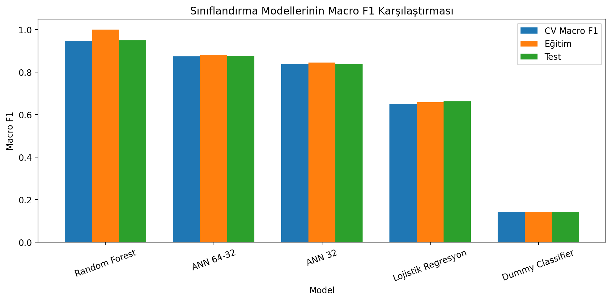
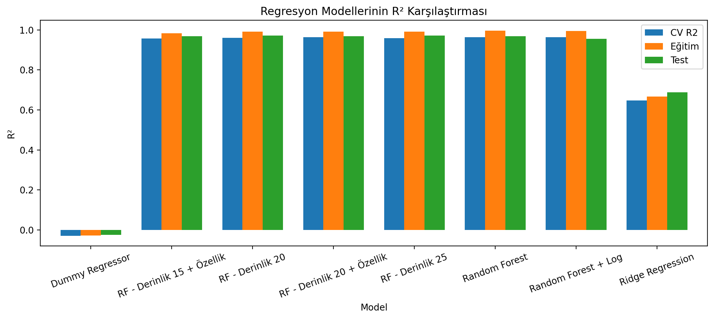
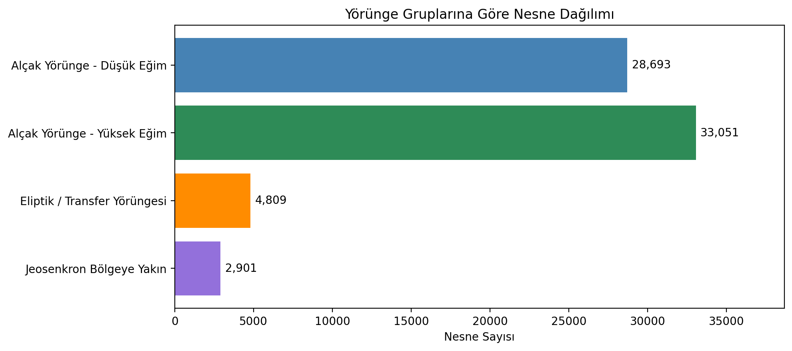

# Uzay Nesnelerinin Makine Öğrenmesi ile Analizi

Bu projede **GCAT (General Catalog of Artificial Space Objects)** veri kümesi kullanılarak uzay nesneleri üzerinde sınıflandırma, regresyon ve kümeleme analizleri gerçekleştirilmiştir.

## Veri Kümesi

- **Kaynak:** [GCAT – General Catalog of Artificial Space Objects](https://planet4589.org/space/gcat/)
- **Dosya:** `satcat.tsv`
- **Kayıt sayısı:** 69.999
- **Özellik sayısı:** 42

## 1. Sınıflandırma

Uzay nesnelerinin türlerini tahmin etmek için Dummy Classifier, Logistic Regression, Random Forest ve iki farklı ANN mimarisi kullanılmıştır.

Modeller 5 katlı çapraz doğrulama ile karşılaştırılmıştır.

**En başarılı model: Random Forest**

- CV Macro F1: 0,9467
- Test Macro F1: 0,9495
- Test Accuracy: %96,72

## 2. Regresyon

Uzay nesnelerinin fiziksel ve yörüngesel özelliklerinden yararlanılarak kütle tahmini yapılmıştır.

Dummy Regressor, Ridge Regression ve Random Forest modelleri karşılaştırılmıştır.

**En başarılı model: Random Forest**

- CV RMSE: 1002,38
- Test RMSE: 1214,81
- Test R²: 0,9690

## 3. Kümeleme

Uzay nesneleri Perigee, Apogee ve Inc özellikleri kullanılarak K-Means algoritmasıyla gruplandırılmıştır.

Silhouette ve Elbow analizleri sonucunda, daha ayrıntılı yorumlama amacıyla dört kümeli çözüm tercih edilmiştir.

Elde edilen gruplar:

- Alçak yörünge – düşük eğim
- Alçak yörünge – yüksek eğim
- Eliptik / transfer yörüngesi
- Jeosenkron bölgeye yakın yörüngeler

## Kullanılan Teknolojiler

Python, Pandas, NumPy, Scikit-learn, Matplotlib ve Google Colab.

## Dosyalar

- `Makine Öğrenmesi Dönem Ödevi.ipynb` — Analiz ve modelleme kodları
- `outputs/` — Sonuç tabloları ve grafikler

## Kaynaklar

- [GCAT – General Catalog of Artificial Space Objects](https://planet4589.org/space/gcat/)
- [Scikit-learn](https://scikit-learn.org/stable/)

